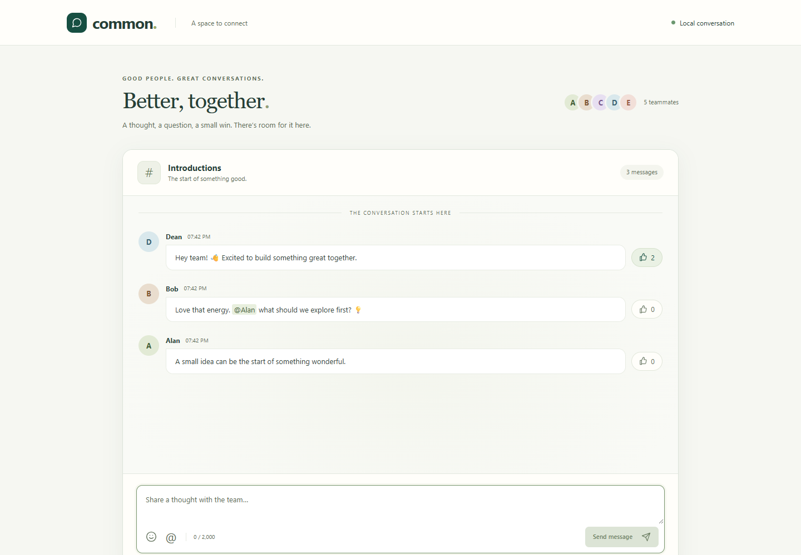

# Common — team chat

A responsive single-page React chat application implementing [the original assignment](reactjs_chat_assignment.md). The conversation appears above a fixed-in-panel composer; each submitted message receives a random author from Alan, Bob, Carol, Dean, and Elin.

## Setup and execution

Use Node 24 LTS (or Node 22.13+ on the 22.x line) and npm 10+.

```powershell
cd chat-app
npm ci
npm run dev
```

Open http://127.0.0.1:5173. No configuration, environment variables, backend, or credentials are needed. Use `npm.cmd` in PowerShell if script execution policy prevents `npm` from running.

## Features and interaction

- Send using the button or Enter; Shift+Enter adds a newline. Blank messages are rejected, messages are trimmed, and input is limited to 2,000 UTF-16 code units.
- Each message gets a fresh random author from the exact required list.
- Its right-side thumbs-up button starts at zero and increases on **every** click. It is not a toggle.
- The emoji picker inserts at the cursor or replaces the selected text.
- Click `@` to list all five teammates; typing `@` filters names. Arrow keys and Enter select a suggestion; Escape dismisses the picker. Mentions are highlighted in sent messages.
- Messages and likes persist under `common.messages.v1` in local storage. Invalid data and storage failures produce an informative notice without preventing conversation.
- Responsive layout, focus states, keyboard controls, safe text rendering, IME-aware Enter handling, and announcements for sent messages.

## Tests and production build

```powershell
npm run lint
npm test
npm run build
npx playwright install chromium
npm run test:e2e
npm audit
npm run preview
```

The production preview is http://127.0.0.1:6173. Browser tests use this production build, with desktop and mobile workflows. If Chrome is already installed, use `$env:PLAYWRIGHT_CHANNEL = 'chrome'` before `npm run test:e2e` instead of downloading Chromium. `npm run test:watch` provides interactive component tests.

## Source map

- `src/App.jsx`: conversation state, persistence, layout and auto-scroll after sending.
- `src/Composer.jsx`: draft, submission, selection-aware emoji and mention controls.
- `src/Message.jsx`: author, timestamp, safe mention formatting, independent likes.
- `src/chat.js`: author list, validation, message creation and stored-record validation.
- `src/Icon.jsx`: small local SVG icons.
- `src/App.test.jsx`, `e2e/chat.spec.js`: component/model and browser tests.

Chat is a local simulation. The five names are not online accounts; there is no authentication, backend, Socket.IO server, or cross-device synchronization. Emoji and mentions fulfill two optional stretch goals. Local storage is specific to the host and port, so the development and preview URLs have separate conversations.



See the [repository README](../README.md) and [verification report](../docs/VERIFICATION.md) for both applications.
